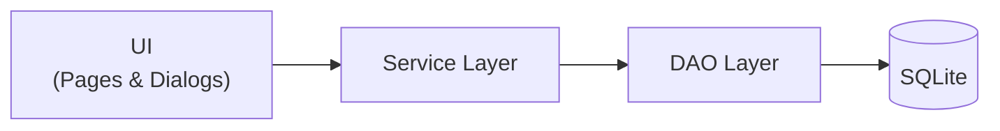
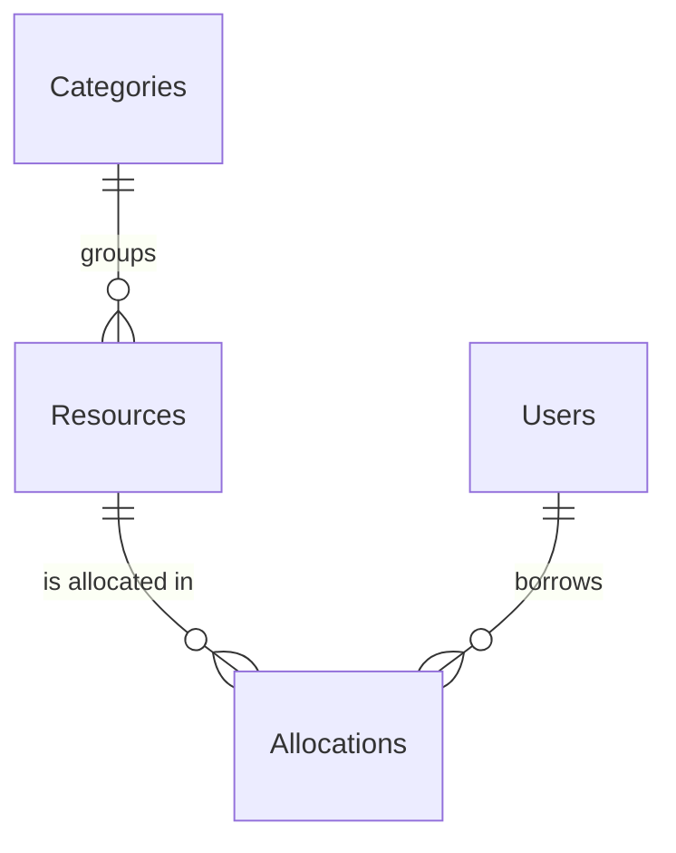

# University Resource Management System (URMS)

**A modern Java desktop application for managing campus assets, lab equipment, audiovisual inventory, venues, borrowers, and resource allocations at Navrachana University.**


---

## Table of Contents

- [Overview](#overview)
- [Features](#features)
- [Tech Stack](#tech-stack)
- [Getting Started](#getting-started)
- [Authentication & Sessions](#authentication--sessions)
- [Architecture](#architecture)
- [Project Structure](#project-structure)
- [Database Schema](#database-schema)
- [UI & Design System](#ui--design-system)

---

## Overview

URMS gives university operators a single place to track what the campus owns, who is borrowing it, and what is currently checked out. It runs as a standalone desktop app with a zero-setup embedded database, so it can be launched on any machine with Java 17 installed.

## Features

| Area | Highlights |
| :--- | :--- |
| **Campus Directory** | Student and faculty registry with enrollment ID tracking, role badges (`STUDENT`, `FACULTY`), live search, and active/inactive filters |
| **Resource Inventory** | Lifecycle tracking for equipment, labs, and consumables with category filtering, stock availability indicators, and modal editing |
| **Allocations** | Checkout, loan, and return records linking resources to borrowers, with due dates and status |
| **Navigation** | Central `CardLayout` shell with isolated page panels under `urms.ui.pages` |
| **Security** | Operator login with salted **BCrypt** hashing and persistent sessions |
| **Modern UI** | **FlatLaf** with HiDPI vector scaling, hover states, and Navrachana crimson branding (`#B32025`); offline **Ikonli** Material icons |
| **Zero-Setup Database** | SQLite with automatic schema creation and seed data on first launch |
| **Deployment** | Self-contained Fat JAR with all dependencies bundled |

## Tech Stack

| Layer | Technology | Version |
| :--- | :--- | :--- |
| Language | Java | 17 LTS |
| UI Framework | Java Swing | - |
| Theme & Styling | [FlatLaf](https://www.formdev.com/flatlaf/) | 3.5.4 |
| Icons | [Ikonli Material Pack](https://kordamp.org/ikonli/) | 12.4.0 |
| Database | SQLite via `sqlite-jdbc` | 3.53.4.0 |
| Password Hashing | jBCrypt | 0.4 |
| Testing | JUnit 5 | 5.10.2 |
| Build | Apache Maven (`maven-shade-plugin` for Fat JAR) | - |

## Getting Started

### Prerequisites

- JDK 17 or later
- Apache Maven 3.6+

### Run with Maven

```powershell
mvn clean compile exec:java
```

### Build and run the Fat JAR

```powershell
# Package the app and all dependencies into one JAR
mvn clean package

# Run it
java -jar target/urms-1.0-SNAPSHOT.jar
```

On first launch, the SQLite database (`resourceregister.db`) is created automatically from `schema.sql` and populated from `seed.sql`.

## Authentication & Sessions

### Default demo credentials

A default administrator is seeded on first run:

| Field | Value |
| :--- | :--- |
| Username | `admin` |
| Password | `admin123` |
| Role | System Administrator |

> **Note:** These credentials are for demonstration only. Change the password before any real deployment. Passwords are salted and verified with BCrypt.

### Session persistence

Operators stay signed in across launches through a rolling 7-day session.

| Stage | Behavior |
| :--- | :--- |
| **Login** | After successful authentication in [`LoginWindow`](src/main/java/urms/ui/LoginWindow.java), [`DatabaseConnection.createSession(username)`](src/main/java/urms/dao/DatabaseConnection.java) stores a UUID token in SQLite that expires in 7 days |
| **Auto-login** | On startup, [`Main`](src/main/java/urms/Main.java) calls `DatabaseConnection.getActiveSessionUser()`; if a valid session exists, the login screen is skipped |
| **Rolling refresh** | Each successful session check extends the expiry by another 7 days from the time of use |
| **Logout** | The sidebar Logout button asks for confirmation, then `DatabaseConnection.clearSession()` resets `session_token` and `token_expiry` to `NULL` and returns to the login screen |

## Architecture

URMS follows a strict layered call flow:



**Rules**

- **No SQL in the UI.** Actions go through services for validation and business rules, which then delegate persistence to DAOs.
- **Separation of concerns.** The DAO and model layers contain no Swing imports, which keeps domain logic clean and unit-testable.
- **Explicit imports.** Source files avoid wildcards (`import javax.swing.JButton`, not `import javax.swing.*`).

## Project Structure

```text
University-Resource-Management/
├── pom.xml                        # Dependencies, build plugins, Fat JAR shading
├── README.md
├── resourceregister.db            # SQLite runtime database (auto-created)
└── src/main/
    ├── java/urms/
    │   ├── Main.java              # Entry point: theme, DB bootstrap, window launch
    │   ├── model/                 # Domain entities and DTOs
    │   │   ├── Category.java
    │   │   ├── CategorySummary.java
    │   │   ├── Resource.java
    │   │   └── User.java
    │   ├── dao/                   # Data access (pure SQL)
    │   │   ├── DatabaseConnection.java   # Connection, schema runner, auth/session
    │   │   ├── CategoryDAO.java
    │   │   ├── ResourceDAO.java
    │   │   └── UserDAO.java
    │   ├── service/               # Business logic and validation
    │   │   ├── CategoryService.java
    │   │   ├── ResourceService.java
    │   │   └── UserService.java
    │   ├── ui/                    # Swing components
    │   │   ├── DefaultWindow.java        # App shell (CardLayout)
    │   │   ├── LoginWindow.java
    │   │   ├── SidebarPanel.java
    │   │   ├── dialogs/
    │   │   │   ├── ResourceModalDialog.java
    │   │   │   └── UserModalDialog.java
    │   │   └── pages/
    │   │       ├── CategoryPanel.java
    │   │       ├── ResourcePanel.java
    │   │       └── UserPanel.java
    │   └── util/
    │       ├── AppConfig.java            # Environment and DB path resolution
    │       └── ColorConstants.java       # Branding and theme palette
    └── resources/
        ├── db/
        │   ├── schema.sql
        │   └── seed.sql
        └── images/
            └── navrachana_logo.png
```

## Database Schema

The schema lives in [`schema.sql`](src/main/resources/db/schema.sql). All primary keys are UUIDs.



| Table | Purpose | Columns |
| :--- | :--- | :--- |
| **Admin** | Operator accounts | `admin_id`, `username`, `password_hash`, `full_name`, `session_token`, `token_expiry`, `is_active` |
| **Users** | Campus borrowers | `user_id`, `enrollment_no`, `full_name`, `role` (`STUDENT` \| `FACULTY`), `is_active`, `created_at` |
| **Categories** | Resource groupings | `category_id`, `category_name`, `description`, `is_active` |
| **Resources** | Equipment, labs, assets | `resource_id`, `resource_name`, `category_id` (FK), `resource_type`, `location`, `total_quantity`, `available_quantity`, `is_active` |
| **Allocations** | Checkouts, loans, returns | `allocation_id`, `resource_id` (FK), `user_id` (FK), `quantity`, `issue_date`, `due_date`, `return_date`, `status`, `issued_by`, `remarks` |

## UI & Design System

Theme values are centralized in `ColorConstants`.

| Token | Value | Use |
| :--- | :--- | :--- |
| `BRAND_CRIMSON` | `#B32025` | Primary brand color |
| `BRAND_CRIMSON_HOVER` | `#99181D` | Hover state for primary actions |
| `TEXT_PRIMARY` | `#1C4E6F` | Navy text and accents |
| `BLUE_ACCENT` | `#2563EB` | Secondary accent |
| Canvas / Cards | `#F2F6F9` / `#FFFFFF` | Page background and card/dialog surfaces |

**Button architecture:** custom buttons call `setContentAreaFilled(false)` and `setOpaque(true)` and use `MouseAdapter` listeners for hover darkening and active/disabled feedback. This gives consistent color and icon rendering and avoids native Look and Feel glitches.